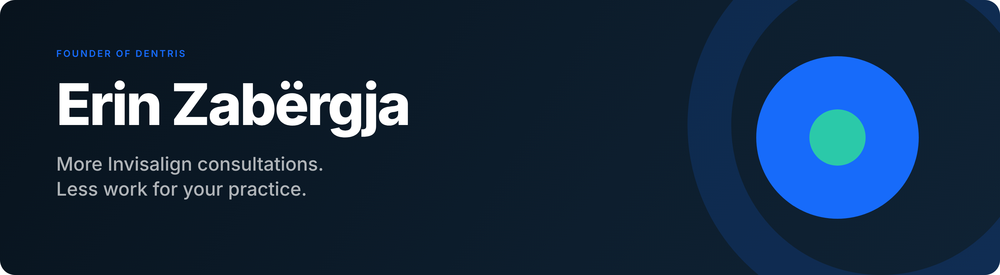
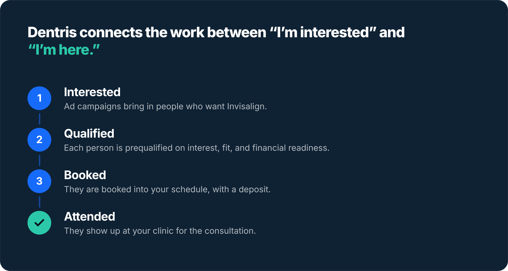
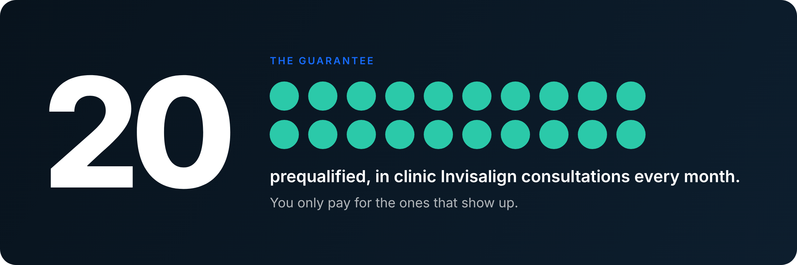

[Website](https://www.dentris.app) &nbsp;&nbsp;|&nbsp;&nbsp; [LinkedIn](https://linkedin.com/in/erinzabergja) &nbsp;&nbsp;|&nbsp;&nbsp; [Email](mailto:erin@dentris.app)

 

## About

I'm Erin, the founder of **[Dentris](https://www.dentris.app)**, the growth partner for Invisalign practices.

I help dentists and orthodontists in the US, Canada, and the UK fill their Invisalign consultation schedule with patients who are ready and who actually show up.

Most practices don't have a lead problem. They have a gap between "I'm interested" and "I'm here." Dentris closes that gap and handles the work in between, so your team can focus on patient care.

 

## The Dentris pipeline

The practice takes care of the patient and the treatment. Dentris takes care of everything that gets the patient to your door, and supports your team with consultation scripts, presentations, and coaching.

 

## The guarantee

Missed consultations are refunded, and there are no long term contracts. I work with one practice per area.

 

## How I think about growth

> Leads don't grow a practice. Patients in the chair do.

- The number that matters is the cost per attended consultation, not the cost per lead.
- Follow up and booking are where most practices lose patients, so that is where I focus.
- Reusable systems beat manual work, so I build systems for tracking, follow up, and reporting.

 

## What I work with

Meta Ads, lead qualification, appointment booking, patient follow up, CRM and automation, landing pages and funnels, and performance tracking. I also write code in HTML, CSS, JavaScript, Python, and C# to build and automate things for Dentris.

 

## Work with me

If you run a dental or orthodontic practice that offers Invisalign or clear aligners, let's talk.

- **Book a demo call:** [calendly.com/dentris/democall](https://calendly.com/dentris/democall)
- **Website:** [dentris.app](https://www.dentris.app)
- **Email:** [erin@dentris.app](mailto:erin@dentris.app)
- **LinkedIn:** [linkedin.com/in/erinzabergja](https://linkedin.com/in/erinzabergja)

Dentris is not affiliated with Align Technology. Invisalign is a trademark of Align Technology, Inc.
